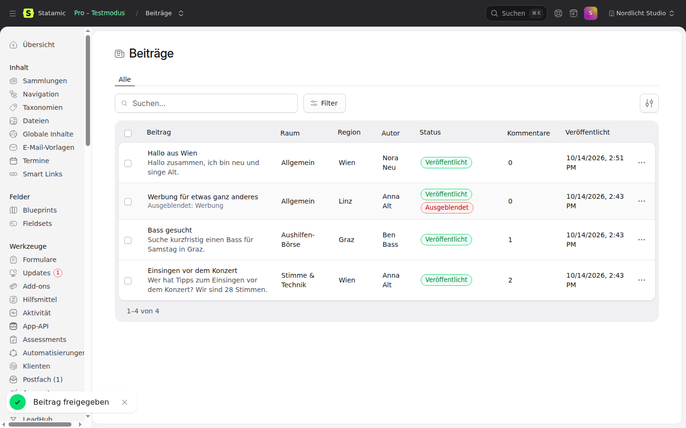
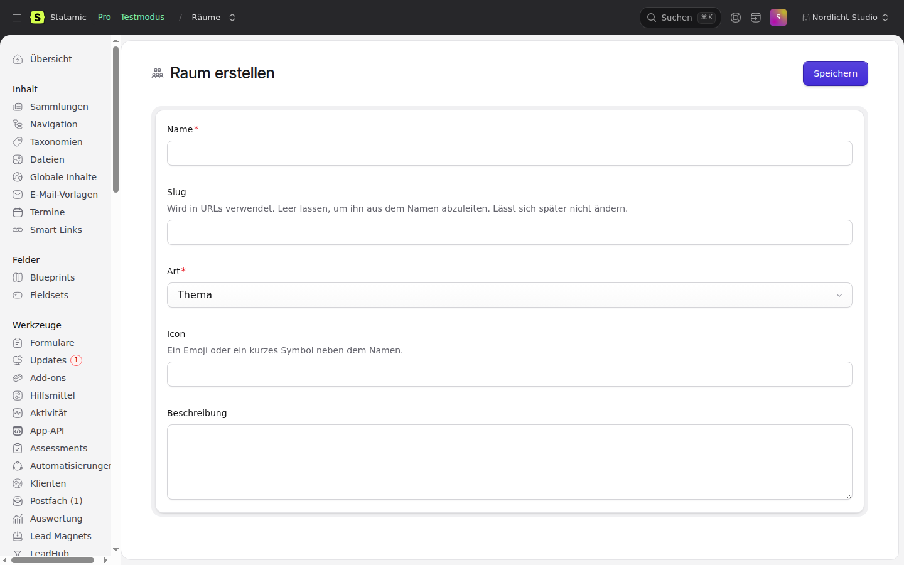

# Community for Statamic

Curated rooms, posts, comments and reactions with a chronological feed. Posting as a team uses `goldnead/statamic-teams`. The public side has no routes and no UI: a site builds those on the services. The Control Panel has a moderation backend.

## Requirements

- PHP 8.2+, Statamic 6, Laravel 12.40+ or 13
- `goldnead/statamic-teams` (posting as a team, the `post as team` permission)
- optional: `goldnead/statamic-accounts` (confirmed accounts, personal data export and erasure)

## Installation

```bash
composer require goldnead/statamic-community
php artisan migrate
php artisan db:seed --class='Goldnead\Community\Seeders\RoomSeeder'
php artisan vendor:publish --tag=community-config   # optional
```

`goldnead/statamic-teams` and `goldnead/statamic-accounts` are not on Packagist yet. Until they are, the installing site needs their repositories in its own `composer.json` (`repositories` is only read from the root package).

## Usage

```php
use Goldnead\Community\Services\PostService;

$post = app(PostService::class)->create($user, '<p>Hallo Chor</p>', room: $room, title: 'Willkommen');
$feed = app(PostService::class)->feed($room)->paginate(20);
```

`CommentService`, `ReactionService` and `RoomService` work the same way. Every write is authorised by `CommunityPolicy` and throws `AuthorizationException` when the account may not do it, or `CommunityException` for an empty, oversized or invalid input.

## Control Panel

A **Community** section in the navigation, with Posts, Comments and Rooms, and a dashboard widget (add it under `widgets` in `config/statamic/cp.php` with `type => community`).

- **Posts and Comments:** core's listing with search and filters (room, region, status, visibility, author person or team). Approve (pre-moderation), hide with a reason, show again and delete work per row and in bulk, through `PostService` and `CommentService`.
- **Rooms:** list with member and post counts, create and edit with core's publish form. `kind` must be one of `Room::KINDS`. Pin one published post per room; it leads that room's feed.
- **Widget:** posts and comments of the last 7 days, posts waiting for approval, hidden items.
- Authors appear by display name only (a team post by the team name), never by e-mail address or account id, and the search never looks at either.

Permissions: `view community` opens the screens, `moderate community` (below it) lets you change things.




The CP is written in English; `lang/de.json` translates it. The built assets in `dist/` are committed; after changing `resources/` run `npm ci && npm run build` (CI fails when `dist/` is stale).

## Model

- `Room`: `region`, `style` or `topic` (validated against `Room::KINDS`), curated flag, `archived_at`, an optional pinned post. `RoomMembership` per account.
- `Post`: author (account, optionally as a team), category, room, region, title, sanitised HTML body, `status` (`published`, `pending`), `hidden` with an optional reason.
- `Comment`: one level of replies, sanitised HTML body, `hidden`.
- `Reaction`: one per account and target (post or comment); reacting again changes the kind, and a double click returns the existing reaction instead of failing.

## Rules

- Curated rooms live in `community.rooms`. `RoomSeeder` (or `RoomService::syncCurated()`) creates them by slug, idempotent.
- Posting, commenting and reacting need a confirmed account (`email_verified_at`, or `accounts.verification.field`). `community.require_confirmed` turns this off.
- As a team: only with the team permission `post as team` (owner has it).
- Edit: author only, and only while the account is confirmed. Delete: author, or a moderator (`moderate community`). Moderators hide and restore with `PostService::hide()`.
- Pre-moderation (`community.pre_moderation`, default off): a new post is `pending` until `PostService::approve()`. Approving is atomic: of two moderators approving at once, only one publishes and fires `PostCreated`. Moderators and accounts with `trusted_after` published posts skip the queue. Off means nobody on a fresh install is silenced; on means the first post of a newcomer needs a moderator.
- `PostService::feed($room, $region)` returns a query ordered by `published_at`, then id. Reactions never change the order (the one pinned post of a room leads its feed). An index on `(status, hidden, published_at)` serves it. Pending and hidden posts are not in it.
- Bodies keep only `community.allowed_tags` and `allowed_attributes`: no scripts, no event handlers, links only with `http`, `https`, `mailto` or `tel` (or relative). Bodies over 60000 bytes are refused, titles and regions are cut at 255 characters.
- `PostCreated` fires when a post becomes public (creation, or approval), `CommentCreated` per comment, both after commit.

## Personal data

With `goldnead/statamic-accounts`, `CommunityContributor` is tagged for export and erasure. Erasing an account deletes its posts, comments, reactions and memberships, plus comments on its posts, replies to its comments and the reactions to them.

## Tests

```bash
composer install
vendor/bin/phpunit
vendor/bin/phpunit -c phpunit.mysql.xml   # needs a MySQL server, see the file
vendor/bin/pint --test
vendor/bin/phpstan analyse
```
